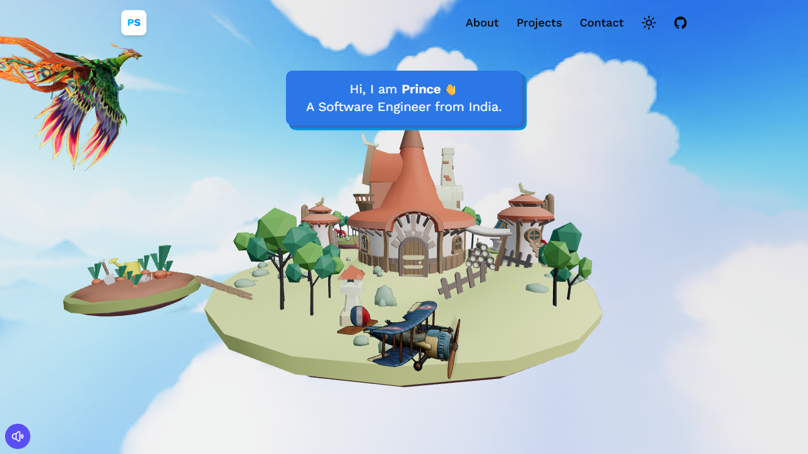
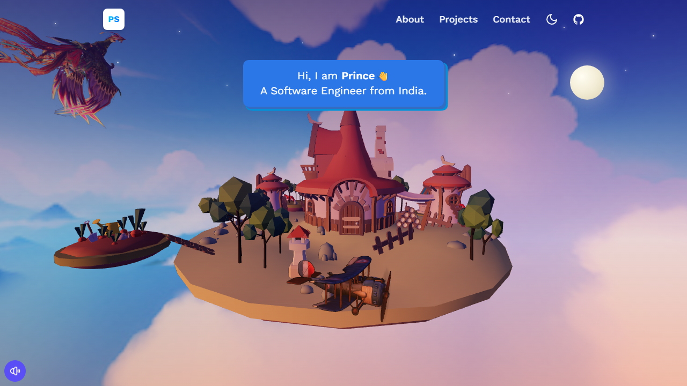
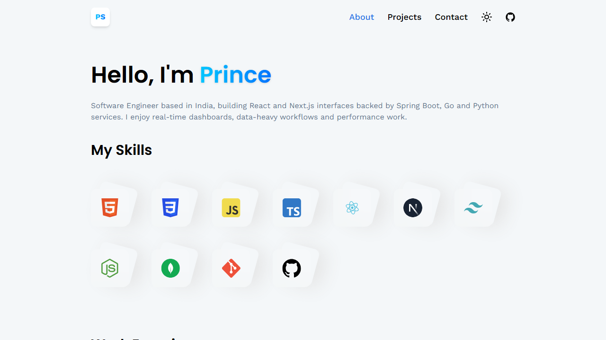
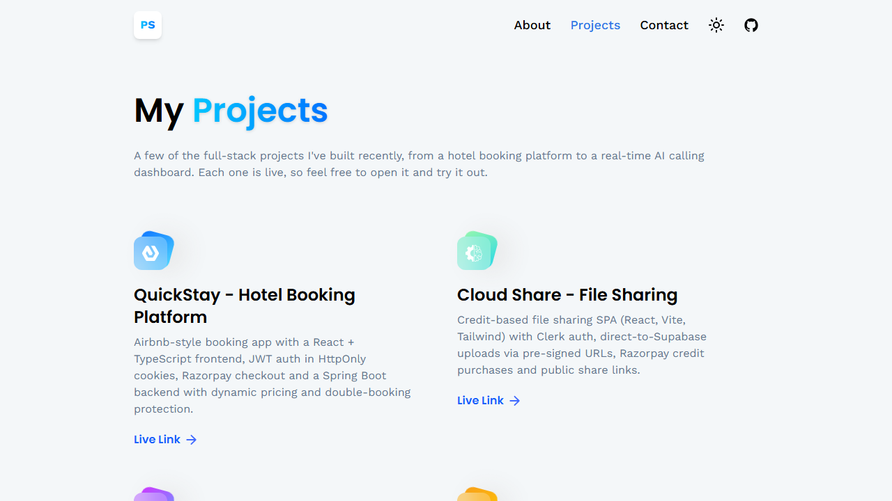
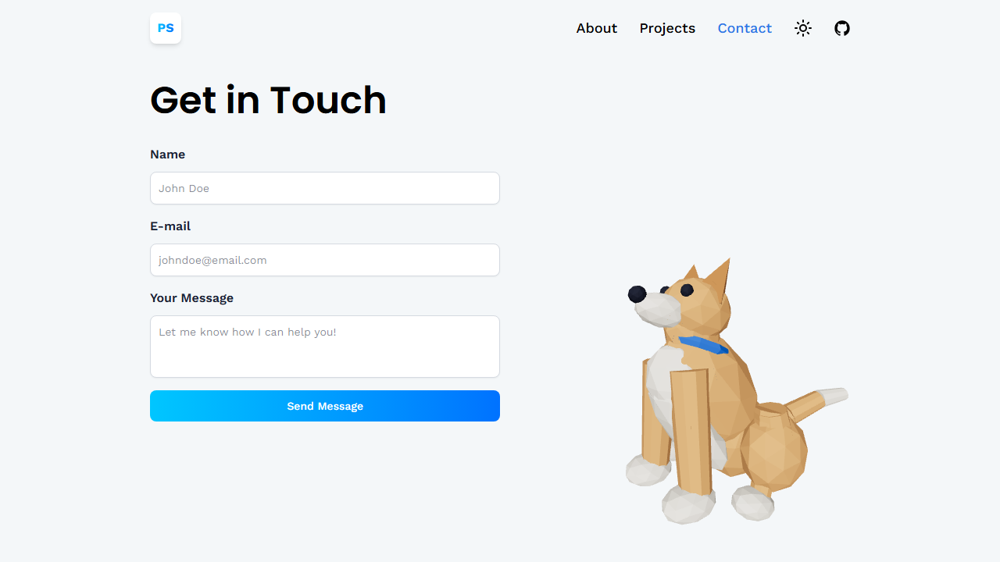
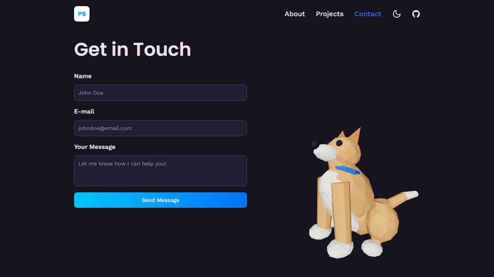

# Prince Satapathy | 3D Portfolio

My personal portfolio: a 3D island home page, an About page with my skills and experience, my projects, and a contact page with a small dog that sits and wags its tail when you hover over it. Built with React and Three.js, hosted on Cloudflare Pages.

## What is on the site

- **Home** - a 3D floating island you can rotate by dragging, with background music you can switch on and off.
- **About** - skills and a work-experience timeline.
- **Projects** - the projects I have built, with links to the live versions.
- **Contact** - a contact form that emails me, next to a low-poly dog. The dog sits by default, wags its tail when hovered, stands up when double-clicked (and walks when hovered while standing), and reacts when the form is sent.
- **Day and dusk themes** - a toggle in the navigation bar. A first visit follows the system light or dark setting, and the choice is remembered.
- Installable as an app (PWA).

## Screenshots

Taken with the Playwright command-line tool (1280x720).

| Home (day) | Home (dusk) |
|---|---|
|  |  |

| About | Projects |
|---|---|
|  |  |

| Contact (day) | Contact (dusk) |
|---|---|
|  |  |

To retake them, build and serve the site (`npm run build`, `npm run preview`), then run for each page, for example:

```bash
npx playwright screenshot --viewport-size 1280,720 --wait-for-timeout 7000 http://127.0.0.1:4173/ docs/screenshots/home-day.png
```

Add `--color-scheme dark` for the dusk theme.

## Tech stack

- React 19, TypeScript, Vite
- Tailwind CSS 4
- Three.js with `@react-three/fiber` and `@react-three/drei`
- React Router 7
- Cloudflare Pages (hosting) and a Pages Function for the contact form
- Resend (email delivery), optional Google reCAPTCHA v3

## Run it locally

You need Node.js 20 or newer.

```bash
npm install
npm run dev
```

Open the address it prints (usually http://localhost:5173).

| Command | What it does |
|---|---|
| `npm run dev` | Start the dev server with live reload |
| `npm run build` | Type-check and build the site into `dist/` |
| `npm run preview` | Serve the built site locally |
| `npm run lint` | Check the code style |
| `npm run check:contact` | Test the contact function with a mocked network (sends nothing) |
| `npm run test:dog` | Test the dog's poses and animations (no browser needed) |
| `npm run test:dog:page` | Test the dog in the real page; needs `npm run preview` running and Playwright |
| `npm run send:test-email` | Send one real test message through the contact function (needs a key, see below) |

The dev server does not run the contact function. To try the form with the function locally, build the site and run `npx wrangler pages dev dist`, with the settings below in a `.dev.vars` file.

## Contact form setup

The form posts to `functions/api/contact.ts`, a Cloudflare Pages Function, which emails me through Resend. It reads these settings:

| Name | Required | Meaning |
|---|---|---|
| `RESEND_API_KEY` | yes | Resend API key (keep it secret) |
| `CONTACT_TO_EMAIL` | no | Where messages are delivered (default: princesatapathywork@gmail.com) |
| `RESEND_FROM_EMAIL` | no | Sender, for example `Name <hello@mail.example.com>`. Needs a domain verified in Resend. The default sender can only deliver to the Resend account owner. |
| `VITE_RECAPTCHA_SITE_KEY` and `RECAPTCHA_SECRET_KEY` | no | Turn on Google reCAPTCHA v3 (set both, or neither). The site key is read at build time. |
| `RECAPTCHA_MIN_SCORE` | no | Lowest reCAPTCHA score accepted (default `0.5`) |

On Cloudflare, add them under the Pages project's **Settings -> Variables and Secrets**. Locally, put them in a git-ignored `.dev.vars` (for `wrangler`) or `.env` (for `npm run send:test-email`).

## Deploy

1. Push this repository to GitHub.
2. In Cloudflare, create a **Pages** project from the repository.
3. Build command `npm run build`, output directory `dist`.
4. Add the contact settings above as variables and secrets.

## Project structure

```
functions/api/contact.ts   Cloudflare Pages Function: POST /api/contact
src/
  components/              Navbar, banners, alerts, dusk-sky overlay
  constants/               my name, skills, experience and projects
  context/                 day / dusk theme state
  models/                  3D models: island, bird, plane, sky, and the dog (dogRig.ts + Dog.tsx)
  pages/                   Home, About, Projects, Contact
  server/contactHandler.ts the contact form logic (validation, reCAPTCHA, Resend)
scripts/                   tests and the test-email script
wrangler.toml              Cloudflare Pages settings (no secrets)
```

## Need help?

If you run into trouble setting this up or have a question about it:

- Open an [issue](https://github.com/princesatapathy/Portfolio/issues) on this repository.
- Email me at [princesatapathywork@gmail.com](mailto:princesatapathywork@gmail.com).
- Find me on [GitHub](https://github.com/princesatapathy) or [LinkedIn](https://www.linkedin.com/in/prince-satapathy-8a2897369).

## Credits

- **Island** 3D model: "Fox's islands" by nimzu on Sketchfab, licensed under [CC BY 4.0](http://creativecommons.org/licenses/by/4.0/) - https://sketchfab.com/3d-models/foxs-islands-163b68e09fcc47618450150be7785907
- The bird, plane and sky models, and the background music, came with the open-source template this site started from. Their original authors are not recorded in this repository.
- This site started from an open-source, MIT-licensed 3D portfolio template. Its required license notice is in [THIRD_PARTY_NOTICES.md](THIRD_PARTY_NOTICES.md).
- The dog is built from code in `src/models/dogRig.ts`, with no external model.

## License

MIT, see [LICENSE](LICENSE).
